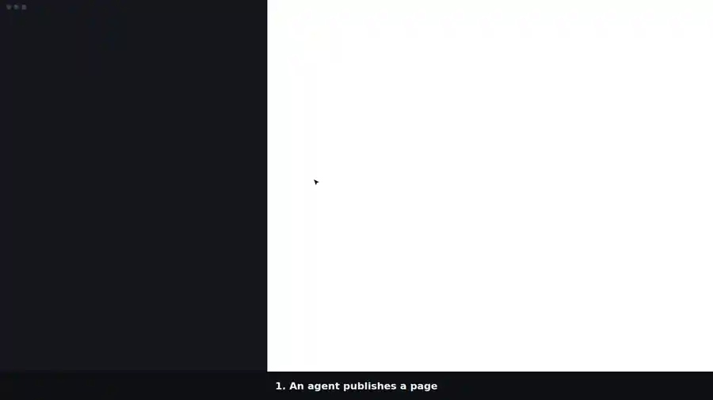
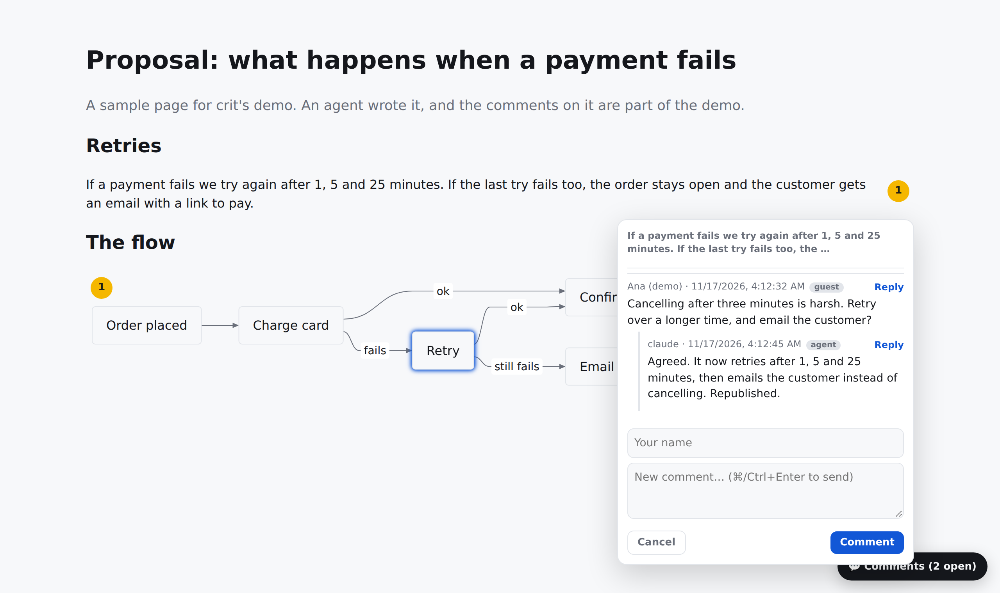

# crit

A place for the pages your coding agents make (research, spikes, plans, mockups, reviews, with images and video),
on your own Cloudflare account, at one address. Agents publish a page in about a second. The team opens it signed
in; a page can also be made public, or shared by a link. People comment on any heading, paragraph, diagram node or
selected text. Agents read the comments and answer; people resolve.

crit is a recipe, not a service or a package. A project copies [`template/`](template/), fills in one config file
and deploys it once. The project owns the code from then on. [`SKILL.md`](SKILL.md) is the prescription an agent
follows to add it: tell your agent "add crit to this project".

**Try it:** [crit.kris.gg/p/demo](https://crit.kris.gg/p/demo/) is a public crit page. Hover or tap anything on it and
leave a comment.



The recording is the page at [crit.kris.gg/p/review-loop](https://crit.kris.gg/p/review-loop/). The reviewer in it
is part of the demo. A signed-in teammate resolves a thread; an agent has no way to.



## What you need

- **Bun 1.4.4** or later. The scripts and the Markdown renderer run on Bun.
- **macOS or Linux** to work on crit itself: the lint and typecheck tools ship no Windows build. Publishing and
  deploying need only Bun.
- **A Cloudflare account** with R2 turned on. Cloudflare asks for a payment method before it enables R2, also within
  the free allowance.
- **For a team sign-in:** Cloudflare Zero Trust on the account, which is free for up to 50 people, and a domain whose
  zone is in the account (or the account's workers.dev name).
- crit pins **Alchemy 2** (a beta, `2.0.0-beta.85`) and **Effect 4**. A project that copies the template uses its own
  pins where it has them.

The free Workers plan limits CPU time per request. crit reads each uploaded text file of up to 5 MiB for secrets, and
that has not been measured against the free plan's limit.

## Try it in a few minutes, with no domain and no sign-in

This is the smallest mode: public pages and share links on the Worker's workers.dev address.

1. **Make an API token** in the Cloudflare dashboard (My Profile › API Tokens › Create Custom Token) for your account
   with these permissions: Workers Scripts Write, D1 Write, Workers R2 Storage Write and Secrets Store Write. The
   last one is for the small state store crit's deploy keeps on the account. The account id is on the account's
   overview page in the dashboard.
2. **Get the code:**

   ```sh
   git clone https://github.com/grmkris/crit && cd crit && bun install
   cd template
   ```

3. **Fill in `crit.config.ts`:** set `name` (for example `my-crit`) and `account` (your account id). Leave `domain`
   undefined and `access` as `{ kind: 'none' }`. Set `publicPages: true` and `outsiders: 'comment'` to try public
   pages and visitors' comments.
4. **Put the secrets in two files only you can read.** The subshell keeps the `umask` from staying on in your shell:

   ```sh
   (umask 077 && mkdir -p .local &&
     printf 'CLOUDFLARE_API_TOKEN=%s\nCLOUDFLARE_ACCOUNT_ID=%s\n' '<your token>' '<your account id>' > .local/cloud.env &&
     printf 'CRIT_PUBLISH_TOKEN=%s\n' "$(openssl rand -base64 32)" > .local/crit.env)
   ```

5. **Deploy:** `bun run deploy`. It shows a plan, then makes a Worker, a D1 database, an R2 bucket and the state
   store, and ends by printing the Worker's address (`url: 'https://my-crit.<your subdomain>.workers.dev'`). Add
   that address to `.local/crit.env` as a line `CRIT_URL=https://…`.
6. **Publish the starter page and open it:**

   ```sh
   bun run publish _template
   bun run share _template                  # prints a link that opens the page in any browser
   bun run visibility _template public      # the page is now also at <address>/p/_template/
   bun run comments                         # what visitors wrote, as Markdown
   ```

This token list is the one a deploy with a domain and a sign-in ran with, without its Access and zone rights. If your
first deploy is refused for a missing right, the error names it.

## Three ways in, one address

|               | The team                                             | A public page                                          | A share link                        |
| ------------- | ---------------------------------------------------- | ------------------------------------------------------ | ----------------------------------- |
| Address       | `/` and `/<page>/`                                   | `/p/<page>/`                                           | `/s/<token>/<page>/`                |
| Who           | The emails you list, by a code Cloudflare mails them | Anyone                                                 | Anyone who has the link             |
| What they see | The index and every page                             | That page                                              | That page                           |
| Comments      | As themselves; they resolve threads                  | As `outsiders` allows: none, read, or as a named guest | The same                            |
| Ends          | When you remove their email                          | When someone closes the page                           | When the link expires or is revoked |

A page is the team's until someone opens it: an agent with `publish --public` or `visibility`, or a signed-in
member with a button on the index. Public pages are off unless the config says `publicPages: true`.

Teammates need no Cloudflare account. The sign-in is Cloudflare Access with its emailed code, which the stack
declares.

## The modes

One config file, `template/crit.config.ts`, picks the mode.

**No team side** (the quickstart above): pages open in public or by share links.

```ts
domain: undefined,
access: { kind: 'none' },
```

**A domain and a team sign-in:**

```ts
domain: { zone: 'example.com', host: 'team.example.com' },
access: {
  kind: 'cloudflare',
  team: 'https://example.cloudflareaccess.com',
  emails: ['ana@example.com', 'bo@example.com'],
  sessionDuration: '720h',
},
names: { 'ana@example.com': 'Ana' },
```

**workers.dev and a team sign-in** (built, not yet run on Cloudflare):

```ts
domain: undefined,
access: {
  kind: 'cloudflare',
  team: 'https://example.cloudflareaccess.com',
  emails: ['ana@example.com'],
  sessionDuration: '720h',
  workersDevSubdomain: 'example', // the `example` of example.workers.dev
},
```

A project that keeps people's addresses out of its repository leaves `emails` and `names` empty and lists the team in
the publish-env file instead: `CRIT_TEAM=ana@example.com=Ana,bo@example.com=Bo`.

### One-time setup for a team sign-in

1. **Turn on Zero Trust** for the account and choose a team name; `access.team` is
   `https://<team name>.cloudflareaccess.com`. In the dashboard this is under Zero Trust. Over the API it is
   `POST /accounts/<account id>/access/organizations` with `{ "name": "<team name>", "auth_domain": "<team name>.cloudflareaccess.com" }`.
2. **Add the One-time PIN login method** (Zero Trust settings, under authentication or login methods). Over the API:
   `POST /accounts/<account id>/access/identity_providers` with `{ "name": "Email code", "type": "onetimepin", "config": {} }`.
   crit looks this method up and never creates or deletes it.
3. **Give the deploy token these rights:**
   - on the account: Workers Scripts Write, D1 Write, Workers R2 Storage Write, Secrets Store Write, Access: Apps and
     Policies Write, and Access: Organizations, Identity Providers, and Groups Read;
   - on the zone, for a domain: Workers Routes Write, DNS Write and Zone Read.
4. `bun run deploy`. It makes the two Access applications before the Worker.

Labels in the Cloudflare dashboard change; the two API calls above are the ones a real setup was made with.

## How agents use it

From the project, with only a publish token. In a project that copied the template to `apps/crit`, each command is
`bun run --cwd apps/crit <command>`:

| Command                                    | What it does                                                                                          |
| ------------------------------------------ | ----------------------------------------------------------------------------------------------------- |
| `publish <slug>`                           | Publishes `pages/<slug>/`: HTML, images, video. Only changed files are sent, and there is no deploy   |
| `publish <slug> --from ../../docs/plan.md` | Publishes a Markdown file as a page, with Mermaid drawn by [pele](https://github.com/obsidianmd/pele) |
| `share <slug> [--days N] [--revoke [id]]`  | Makes a share link, or ends one or all of a page's                                                    |
| `visibility <slug> public\|team`           | Opens a page to anyone at `/p/<slug>/`, or closes it to the team                                      |
| `comments [slug]`                          | Prints open threads as Markdown                                                                       |
| `comments reply <thread> "…"`              | Answers a thread                                                                                      |
| `pages`, `keep <slug>`                     | Lists pages; exempts one from expiry                                                                  |

[`template/AGENTS.md`](template/AGENTS.md) is what a project's agents read.

**Over MCP.** An agent without a shell uses the same things as tools at `https://<address>/mcp`, with the publish
token as a bearer token. A client config that works with Claude Code (`--mcp-config`, or `.mcp.json`):

```json
{
  "mcpServers": {
    "crit": {
      "type": "http",
      "url": "https://team.example.com/mcp",
      "headers": { "Authorization": "Bearer ${CRIT_PUBLISH_TOKEN}" }
    }
  }
}
```

The tools are `pages_list`, `page_publish`, `page_visibility`, `page_share`, `link_revoke`, `comments_read` and
`comment_reply`. There is no tool to resolve a thread. Chat apps that accept only OAuth connectors cannot add it:
crit has a token, not an OAuth sign-in.

## How it is built

One small Worker on one address, with a D1 database and an R2 bucket. The deploy also keeps a second, tiny Worker on
the account, `<name>-state`, which holds the deploy's own state.


- Cloudflare Access stands in front of the private paths, and a second Access application lets the open paths
  through (`/p/*`, `/s/*`, `/api/*`, `/mcp`, `/lib/*`).
- The Worker checks Access's token itself on every private path, so nothing private opens through an address or a
  path Access does not guard.
- Files are stored once under their hash; a page is a list of files per version, and the last five versions are
  kept.
- The dependencies are Alchemy, Effect and pele.

[`docs/STACK.md`](docs/STACK.md) has the details, [`docs/request-flow.mmd`](docs/request-flow.mmd) the request flow
as a diagram source, and [`docs/STATUS.md`](docs/STATUS.md) what has run where.

## What protects what

- **Private pages have two guards:** Cloudflare Access in front, and the Worker's own check of the token Access
  signs (signature, application, issuer, expiry). A request that reaches the Worker any other way gets a 403.
- **A public page has its own address** (`/p/<page>/`). Opening a page never opens the team's address for it.
- **The share link's token is in the address** (`/s/<token>/<page>/`), not in a cookie, so relative images and video
  just work. A token is 128 random bits, stored only as a hash, opens exactly one page, and can be revoked by its
  id.
- **Everything is sent with** `noindex`, `no-referrer` and `nosniff`, and the Worker does not log request addresses.
- **Agents hold a publish token, never your Cloudflare token.** The publish token can publish, open and remove any
  page and read every comment, so keep it in a file only you can read.
- **Secrets are refused twice:** by the publish script before upload, and by the Worker at commit.

[`SECURITY.md`](SECURITY.md) says how to report a problem.

## Limits you should know

- **Every page on the address shares one origin.** A script in any page, public and shared ones included, can do
  what its reader can: opened by a signed-in teammate, it can read the private pages and comment as them. Publish
  only what your own agents made.
- **A public page and a share link are public** and stay in browser history and chat previews. Do not open or share
  a page that holds private or personal data.
- A file is at most 25 MiB; a page at most 500 MiB and 2,000 files.
- A comment stays on its block while the block's text, or its `data-review-id`, stays the same.
- No drawing on pages, and no comments pinned to a version.

**What has run on Cloudflare.** On a custom domain behind Cloudflare Access: the sign-in redirect, a member
commenting under their name, public pages, share links with byte ranges for video, the agents' API, `/mcp`, and the
template's own `deploy`. The mode with no team side runs on workers.dev.

**Built and tested locally, not yet seen on Cloudflare:** a team sign-in on a workers.dev name, `outsiders: 'none'`,
the "sign in again" message when a session ends mid-comment, the hourly clean-up firing by itself, and files near
25 MiB.

## Working on crit

`bun run check` runs the format check, lint, typecheck, unused-code and duplicate checks and the unit tests.
`bun run test:native` runs the Worker locally in workerd. [`CONTRIBUTING.md`](CONTRIBUTING.md) has the rest, and
[`CHANGELOG.md`](CHANGELOG.md) says what changed and how a project that copied the template picks changes up.

## Licence

MIT. See [LICENSE](LICENSE).
